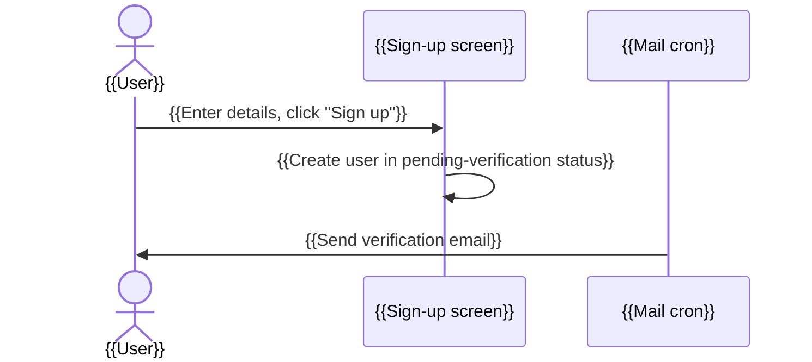

<!--
TEMPLATE: one business flow (flows/<flow>.md)
- {{...}} are placeholders to fill in. Remove all comments when generating the doc.
- A flow only summarizes each step and links back to the screen/cron job; do not copy the details.
- Write according to convention.md.
-->
# {{Flow name}}

* **Purpose:** {{...}}
* **Actors:**
  * {{user role}}
  * {{cron job / external system}}
* **Start condition:** {{...}}
* **End result:** {{...}}

## 1. Diagram

## 2. Steps

| No | Actor | Action | Screen / Cron job | Data changes |
|---|---|---|---|---|
| 1 | {{User}} | {{...}} | [{{Sign-up screen}}](../features/{{group}}/{{screen}}.md) | {{Create user ([`users`](../database.md#users))}} |

## 3. Branches / errors

* {{case}} → {{result}}

## Sources

* `{{file path}}`
