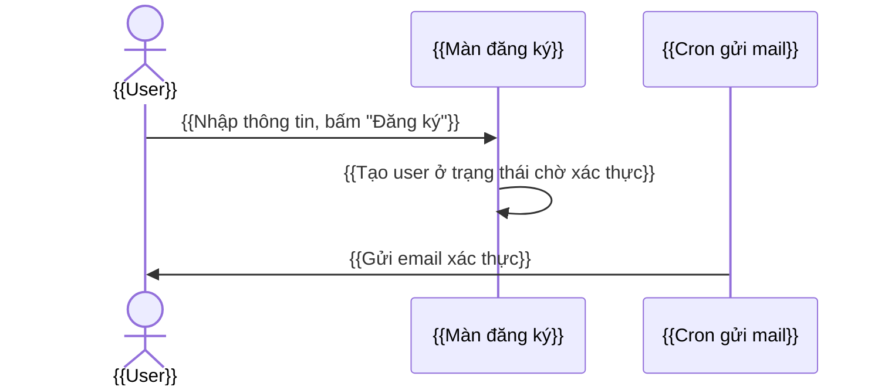

<!--
TEMPLATE: một flow nghiệp vụ (flows/<flow>.md)
- {{...}} là chỗ cần điền. Xóa toàn bộ comment khi sinh tài liệu.
- Flow chỉ tóm tắt từng bước và link về màn/cron job, không chép lại chi tiết.
- Viết theo convention.md.
-->
# {{Tên flow}}

* **Mục đích:** {{...}}
* **Actor:**
  * {{role người dùng}}
  * {{cron job / hệ thống ngoài}}
* **Điều kiện bắt đầu:** {{...}}
* **Kết quả khi kết thúc:** {{...}}

## 1. Sơ đồ

## 2. Các bước

| No | Actor | Thao tác | Màn / Cron job | Thay đổi dữ liệu |
|---|---|---|---|---|
| 1 | {{User}} | {{...}} | [{{Màn đăng ký}}](../features/{{group}}/{{screen}}.md) | {{Thêm mới user ([`users`](../database.md#users))}} |

## 3. Nhánh rẽ / lỗi

* {{trường hợp}} → {{kết quả}}

## Nguồn

* `{{đường dẫn file}}`
